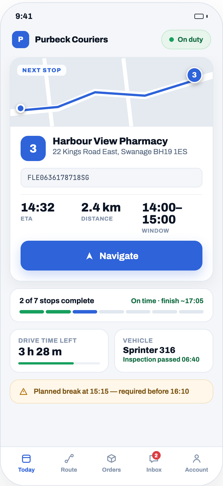

<div id="hero">
  <p align="center" dir="auto">
    <a href="https://fleetbase.io" rel="nofollow">
      
    </a>
  </p>
  <p align="center" dir="auto">
    <a href="https://trendshift.io/repositories/1160?utm_source=repository-badge&amp;utm_medium=badge&amp;utm_campaign=badge-repository-1160" target="_blank" rel="noopener noreferrer"></a>
  </p>
  <p align="center" dir="auto">
    <a href="https://github.com/fleetbase/fleetbase/blob/main/LICENSE.md"></a>
    <a href="https://github.com/fleetbase/fleetbase/releases"></a>
    <a href="https://codecov.io/gh/fleetbase/fleetbase"></a>
    <a href="https://github.com/fleetbase/fleetbase/stargazers"></a>
    <a href="https://discord.gg/V7RVWRQ2Wm"></a>
  </p>
  <p align="center" dir="auto">
    <strong>Open-source logistics and supply chain operating system</strong>
    <br>
    <a href="https://www.fleetbase.io/docs" rel="nofollow">Documentation</a>
    ·
    <a href="https://www.fleetbase.io/docs/api" rel="nofollow">API Reference</a>
    ·
    <a href="https://console.fleetbase.io/onboard" rel="nofollow">Try Fleetbase Cloud</a>
    ·
    <a href="https://tally.so/r/3NBpAW" rel="nofollow">Book a Demo</a>
    ·
    <a href="https://discord.gg/V7RVWRQ2Wm" rel="nofollow">Discord</a>
  </p>
  <hr />
</div>

## What is Fleetbase?

Fleetbase is an open-source, modular operating system for logistics and supply chain operations. It covers dispatch, fleet management, live tracking, commerce, warehousing, and finance in one platform, with a REST API, webhooks, and an extension system for everything else. Run it on your own infrastructure or use [Fleetbase Cloud](https://console.fleetbase.io/onboard).

<p align="center" dir="auto">
  
</p>

## Table of Contents

- [Who Uses Fleetbase](#who-uses-fleetbase)
- [Platform](#platform)
- [Features](#features)
- [Screenshots](#screenshots)
- [Apps](#apps)
- [Getting Started](#getting-started)
- [Releases](#releases)
- [Extensions](#extensions)
- [Roadmap](#roadmap)
- [Documentation](#documentation)
- [Community & Support](#community--support)
- [Contributing](#contributing)
- [Creators](#creators)
- [License](#license)

## Who Uses Fleetbase

Fleetbase is built for teams that move goods, people, or equipment and want to own the software that runs it. Because every workflow, field, and status is configurable, the same platform adapts to very different operations.

| Industry | How Fleetbase is used |
|----------|-----------------------|
| [Trucking&nbsp;&&nbsp;Haulage](https://fleetbase.io/solutions/trucking) | Replace a legacy TMS with real-time tracking, route optimization, and digital proof of delivery. |
| [Courier&nbsp;&&nbsp;Parcel](https://fleetbase.io/solutions/courier-services) | Automate dispatch, raise first-attempt delivery rates, and give customers live parcel tracking. |
| [Food&nbsp;&&nbsp;Grocery&nbsp;Delivery](https://fleetbase.io/solutions/food-delivery) | Run on-demand delivery with instant dispatch, live customer tracking, and automated notifications. |
| [E&#8209;commerce&nbsp;&&nbsp;Retail](https://fleetbase.io/solutions/ecommerce) | Power same-day and next-day delivery and returns through a headless API. |
| [Healthcare&nbsp;&&nbsp;Pharmacy](https://fleetbase.io/solutions/healthcare) | Track chain of custody and prioritize urgent deliveries with full audit trails. |
| [Waste&nbsp;&&nbsp;Recycling](https://fleetbase.io/solutions/waste-management) | Optimize collection routes, track containers, and produce compliance reports. |
| [Container&nbsp;Operations](https://fleetbase.io/solutions/container-operations) | Follow containers across multi-modal journeys from port to door. |
| [Government&nbsp;&&nbsp;Defense](https://fleetbase.io/solutions/government) | Self-host with role-based access, full audit trails, and complete data sovereignty. |

Developers use Fleetbase as a foundation too, building custom logistics products on its API and extension framework.

## Platform

Fleetbase is made up of modules that install into the console as extensions. Each one works on its own and integrates with the rest.

| Module | What it does |
|--------|--------------|
| [Fleet&#8209;Ops](https://www.fleetbase.io/docs/fleet-ops) | Fleet management and dispatch: orders, drivers, vehicles, live tracking, route optimization, configurable workflows, and maintenance. |
| [Storefront](https://www.fleetbase.io/docs/storefront) | Headless commerce for on-demand businesses, with multi-vendor marketplaces and native Fleet-Ops delivery. |
| [Pallet](https://www.fleetbase.io/docs/pallet) | Warehouse management for inventory, pick lists, cycle counts, and fulfilment. |
| [Ledger](https://www.fleetbase.io/docs/ledger) | Invoicing, payments, wallets, and accounting for logistics operators. |
| [Customer&nbsp;Portal](https://github.com/fleetbase/customer-portal) | A self-service workspace for your customers to place and track orders, get quotes and pay, view invoices, manage documents, and open support tickets. |
| [AI](https://fleetbase.io/platform/ai) | Natural-language order creation, operational queries, and order insights powered by OpenAI or Claude. |
| [IAM](https://www.fleetbase.io/docs/platform/identity-and-access/users) | Identity and access management: users, groups, roles, policies, and two-factor authentication across your organization. |
| [Developers](https://www.fleetbase.io/docs/platform/developer-console) | The developer console: API keys, webhooks, socket and system events, and request logs, with separate test and live environments. |
| [Navigator&nbsp;App](https://github.com/fleetbase/navigator-app) | Open-source driver app for iOS and Android with real-time dispatch, navigation, and proof of delivery. |
| [Storefront&nbsp;App](https://github.com/fleetbase/storefront-app) | Open-source iOS and Android app for launching your own shop or marketplace. |

## Features

| Feature | Description |
|---------|-------------|
| **Extensible** | Install extensions from the marketplace or build your own to add features directly into the OS. |
| **Developer friendly** | REST API, WebSockets, and webhooks for integrating external systems or building custom apps. |
| **Configurable workflows** | Define order types with their own activity flows, custom fields, and automation. |
| **Real-time operations** | Track drivers, vehicles, and orders live, with geofences and service zones. |
| **Telematics** | Connect GPS devices and sensors for live feedback from the field. |
| **Identity & access** | Organizations, users, roles, policies, and two-factor authentication. |
| **Dashboards** | Build custom dashboards and widgets for visibility into operations. |
| **Collaboration** | Built-in chat, comments, and notifications across your organization. |
| **Internationalized** | Translate the console into any language. |
| **Self-hosted or cloud** | Run it on your own infrastructure with full control of your data, or let us host it. |

## Screenshots

<table>
  <tr>
    <td width="50%" valign="top">
      
      <p align="center"><strong>Order Board</strong><br>Move orders through each stage on a Kanban board.</p>
    </td>
    <td width="50%" valign="top">
      
      <p align="center"><strong>Live Operations</strong><br>See active and unassigned orders beside your fleet on a live map.</p>
    </td>
  </tr>
  <tr>
    <td width="50%" valign="top">
      
      <p align="center"><strong>Order Config</strong><br>Design custom activity flows, fields, and entities for each order type.</p>
    </td>
    <td width="50%" valign="top">
      
      <p align="center"><strong>Orchestrator</strong><br>Allocate vehicles and drivers, assign orders in batches, and plan and schedule routes before committing.</p>
    </td>
  </tr>
  <tr>
    <td width="50%" valign="top">
      
      <p align="center"><strong>Service Zones & Geofences</strong><br>Define service areas and zones, and watch geofence events as they happen.</p>
    </td>
    <td width="50%" valign="top">
      
      <p align="center"><strong>Storefront</strong><br>Manage products, catalogs, and orders for your shop or marketplace.</p>
    </td>
  </tr>
  <tr>
    <td width="50%" valign="top">
      
      <p align="center"><strong>Ledger</strong><br>Track revenue, invoices, receivables, and wallet balances.</p>
    </td>
    <td width="50%" valign="top">
      
      <p align="center"><strong>Extensions</strong><br>Browse and install free and paid extensions from the marketplace.</p>
    </td>
  </tr>
</table>

## Apps

Fleetbase has two open-source mobile apps, both built with React Native. They connect to Fleetbase Cloud or to your own self-hosted instance, and you can rebrand them and publish them to the App Store and Google Play under your own name.

### Navigator App

<table>
  <tr>
    <td width="34%" valign="top">
      
    </td>
    <td valign="top">

[Navigator](https://github.com/fleetbase/navigator-app) is the driver app for [Fleet&#8209;Ops](https://www.fleetbase.io/docs/fleet-ops). Drivers receive orders as they're dispatched, follow each order's activity flow step by step, navigate to every stop, and capture proof of delivery with photos, signatures or scans. They also report issues, log fuel and chat with dispatch. Their location streams to the console in real time.

**Navigator v3** is a full redesign, in development in [navigator-app#115](https://github.com/fleetbase/navigator-app/pull/115). The screenshot shows its new Today screen. v3 adds:

- A **Today** view with the next stop, its ETA and delivery window, the day's progress, drive time left and break reminders.
- A **Route** tab with the day's manifest, and vehicle **inspections** (DVIR) before a shift.
- An **offline queue**, so steps completed without signal sync once the driver is back online.
- An **Inbox** for order threads and messages from dispatch.
- White-label themes, more languages, and in-app connection to self-hosted instances.

[Source code](https://github.com/fleetbase/navigator-app) · [Releases](https://github.com/fleetbase/navigator-app/releases)

</td>
  </tr>
</table>

### Storefront App

[Storefront](https://github.com/fleetbase/storefront-app) is the customer app for the [Storefront](https://www.fleetbase.io/docs/storefront) extension, for iOS, Android and the web. Launch your own shop or service-booking app, or run a multi-vendor marketplace. Customers browse products, check out with the payment gateway you configure, and follow their order live as Fleet&#8209;Ops delivers it. It runs as a single store, a marketplace of stores, or a food-truck network that shows live trucks on a map.

<p align="center">
  
  
  
</p>

[Source code](https://github.com/fleetbase/storefront-app) · [Releases](https://github.com/fleetbase/storefront-app/releases)

## Getting Started

There are three ways to run Fleetbase:

- **[Fleetbase Cloud](https://www.fleetbase.io/docs/platform/quickstart/cloud-quickstart)**: fully managed, with nothing to install. [Start a free trial](https://console.fleetbase.io/onboard).
- **[Run locally](https://www.fleetbase.io/docs/platform/quickstart/running-locally)**: self-host with Docker on your own machine or server.
- **[Deploy in your cloud](https://www.fleetbase.io/docs/platform/quickstart/deploy-in-cloud)**: run production workloads on AWS, GCP, Azure, or any other provider.

### Quickstart

You need Docker with Docker Compose v2, Git, Node.js 18 or newer, and at least 4 GB of RAM allocated to Docker. Then install the Fleetbase CLI and run the interactive installer:

```bash
npm install -g @fleetbase/cli
flb install-fleetbase
```

When setup finishes, open the console at http://localhost:4200 and create your first admin account and organization. The API is served at http://localhost:8000.

The [running locally guide](https://www.fleetbase.io/docs/platform/quickstart/running-locally) also covers installing with Docker Compose or the setup script, configuring services like mail, maps, and SMS, and troubleshooting. To work on Fleetbase itself, follow the [development setup guide](https://www.fleetbase.io/docs/platform/quickstart/development-setup).

## Releases

Every [release](https://github.com/fleetbase/fleetbase/releases) publishes Docker images. It also attaches standalone binaries and a performance report to the release, and refreshes the database diagram in this repository.

### Standalone binaries

Each release attaches a single-file build of the Fleetbase API for Linux and macOS:

| Platform | Download |
|----------|----------|
| Linux (x86_64) | [`fleetbase-linux-x86_64`](https://github.com/fleetbase/fleetbase/releases/latest/download/fleetbase-linux-x86_64) |
| macOS (Apple Silicon) | [`fleetbase-darwin-arm64`](https://github.com/fleetbase/fleetbase/releases/latest/download/fleetbase-darwin-arm64) |

Each binary is a static [FrankenPHP](https://frankenphp.dev/docs/embed/) build. It bundles the API, PHP and every PHP extension Fleetbase needs (including GEOS for geospatial queries), along with the web server. You don't need PHP or Composer on the machine. You still need MySQL and Redis, configured through the API's usual environment variables, and the console is served separately. Docker remains the recommended way to run Fleetbase in production.

```bash
chmod +x fleetbase-linux-x86_64
./fleetbase-linux-x86_64 php-cli artisan migrate   # run Artisan commands
./fleetbase-linux-x86_64 php-server                # serve the API
```

### Performance report

Each release also attaches a performance report: `performance-report-<version>.html` and `.md`, with the raw numbers in `performance-metrics-<version>.json`. [Open the latest release](https://github.com/fleetbase/fleetbase/releases/latest) to see it.

The report comes from a [k6](https://k6.io) benchmark ([`tests/k6/api-release.js`](tests/k6/api-release.js)) run against a fresh stack booted from source:

- **Throughput.** Ramping load across the public API: orders, places, contacts, drivers, vehicles, fleets and more. It reports average, p50, p90, p95 and p99 latency, requests per second and error rate overall, for reads and writes, and per endpoint. Every figure is compared with the previous release.
- **Rate-limit isolation.** One API key floods the API far past its limit while a second organization and the console keep working. The second organization and the console must get zero `429` responses.

Release pull requests run the same benchmark as a check. Errors and broken rate-limit isolation always fail it. A latency regression fails it only when it's both large and confirmed by a second run. The benchmark runs on a GitHub-hosted runner, so treat the numbers as a comparison between releases, not a prediction of production throughput.

### Database schema (ERD)

[`erd.svg`](erd.svg) is an entity relationship diagram of the full Fleetbase database: core, Fleet&#8209;Ops, Storefront and the other bundled extensions. A [dark version](erd-dark.svg) is also available. A workflow regenerates both from the migrations on every release branch and opens a pull request with the update, so the diagram always matches the latest release.

## Extensions

Extensions add features, integrate external systems, or change how Fleetbase behaves. Browse and install them from the console or with the [Fleetbase CLI](https://www.fleetbase.io/docs/cli), and publish your own to the marketplace as free or paid extensions.

- [Browse and install extensions](https://www.fleetbase.io/docs/platform/extensions/browsing-and-installing)
- [Build your first extension](https://www.fleetbase.io/docs/extension-development/getting-started/quickstart)
- [Extension architecture](https://www.fleetbase.io/docs/extension-development/architecture/overview)

## Roadmap

| Feature | Status | Expected Release | Description |
|---------|--------|------------------|-------------|
| **[Navigator App v3](https://github.com/fleetbase/navigator-app/pull/115)** | In development | October 2026 | Redesigned driver app: Today view, route manifest, vehicle inspections, offline queue, and inbox |
| **[Pallet (WMS)](https://github.com/fleetbase/pallet/pull/9)** | In development | October 2026 | Inventory and warehouse management extension |
| **[Fleetbase Registry v2](https://github.com/fleetbase/registry/pull/4)** | In development | November 2026 | New extension registry service: one catalog, npm and Composer delivery, licensing, and publisher accounts for cloud and self-hosted instances |
| **Dynamic Rules** | Planned | 2027 | Rule builder to trigger events, tasks, and jobs |

Want to influence the roadmap? [Join the discussion](https://github.com/orgs/fleetbase/discussions).

## Documentation

- **[Overview](https://www.fleetbase.io/docs/platform/getting-started/overview)** and **[architecture](https://www.fleetbase.io/docs/platform/getting-started/architecture)**: how the platform fits together
- **[Installation](https://www.fleetbase.io/docs/platform/quickstart/running-locally)**: run Fleetbase locally or [deploy it in the cloud](https://www.fleetbase.io/docs/platform/quickstart/deploy-in-cloud)
- **[System setup](https://www.fleetbase.io/docs/platform/system-setup/services)**: configure mail, maps, SMS, storage, queues, and sockets
- **[API reference](https://www.fleetbase.io/docs/api)**: endpoints, authentication, and [API keys](https://www.fleetbase.io/docs/platform/developer-console/api-keys)
- **[Fleetbase CLI](https://www.fleetbase.io/docs/cli)**: every command for installing, managing, and publishing extensions
- **[Extension development](https://www.fleetbase.io/docs/extension-development/getting-started/quickstart)**: build and publish your own extensions
- **[Database schema](erd.svg)**: an entity relationship diagram of the full database, regenerated with each release ([dark version](erd-dark.svg))

## Community & Support

- **Discord**: Chat with maintainers and other users on [Discord](https://discord.gg/V7RVWRQ2Wm).
- **Discussions**: Ask questions and share ideas in [GitHub Discussions](https://github.com/orgs/fleetbase/discussions).
- **Bugs**: Search the [issue tracker](https://github.com/fleetbase/fleetbase/issues) first, then [open a new issue](https://github.com/fleetbase/fleetbase/issues/new).
- **Security**: Report vulnerabilities privately as described in [SECURITY.md](SECURITY.md).
- **Support plans**: See [community, cloud, and enterprise support options](https://www.fleetbase.io/docs/community/support-plans).
- **Releases**: Read changelogs on the [Releases](https://github.com/fleetbase/fleetbase/releases) page and announcements on the [Fleetbase blog](https://www.fleetbase.io/blog).
- **X**: Follow [@fleetbase_io](https://x.com/fleetbase_io).

## Contributing

We welcome contributions from the community.

- **Report bugs**: [Open an issue](https://github.com/fleetbase/fleetbase/issues/new)
- **Suggest features**: [Start a discussion](https://github.com/orgs/fleetbase/discussions)
- **Submit pull requests**: Read the [Contributing Guide](CONTRIBUTING.md) and the [Code of Conduct](CODE_OF_CONDUCT.md)
- **Translate**: Add or improve a language by following [TRANSLATING.md](TRANSLATING.md)
- **Write documentation**: Help improve the [docs](https://www.fleetbase.io/docs)
- **Build extensions**: Create and share [extensions](https://www.fleetbase.io/docs/extension-development/getting-started/quickstart)

To set up a local development environment, see the [development setup guide](https://www.fleetbase.io/docs/platform/quickstart/development-setup).

## Creators

<table style="border: none;">
  <tr>
    <td align="center" style="border: none;">
      
      <br>
      <strong>Ronald A. Richardson</strong>
      <br>
      Co-founder & CTO
      <br>
      <a href="https://github.com/roncodes">GitHub</a> | <a href="https://www.linkedin.com/in/ronald-a-richardson/">LinkedIn</a>
    </td>
    <td align="center" style="border: none;">
      
      <br>
      <strong>Shiv Thakker</strong>
      <br>
      Co-founder & CEO
      <br>
      <a href="https://github.com/shivthakker">GitHub</a> | <a href="https://www.linkedin.com/in/shivthakker/">LinkedIn</a>
    </td>
  </tr>
</table>

## License

Fleetbase is dual-licensed. Choose the license that fits how you use it.

**Open source (AGPL-3.0).** Fleetbase is released under the [GNU Affero General Public License v3.0](LICENSE.md). You can use, modify, and self-host it freely, including to run your own commercial operations. If you modify Fleetbase and make it available to others over a network, you must release those modifications under AGPL-3.0.

**Fleetbase Commercial License (FCL).** The commercial license removes the AGPL-3.0 obligations. It lets you keep modifications proprietary, build SaaS products on Fleetbase, and white-label or distribute it under your own brand. It also includes support options and IP indemnification.

Read the [licensing overview](https://fleetbase.io/licensing) to see which license applies to you, or see the [Commercial License](https://fleetbase.io/licensing/commercial) for details. Questions go to [hello@fleetbase.io](mailto:hello@fleetbase.io).

---

**Copyright © 2026 Fleetbase Pte. Ltd.** All rights reserved.
